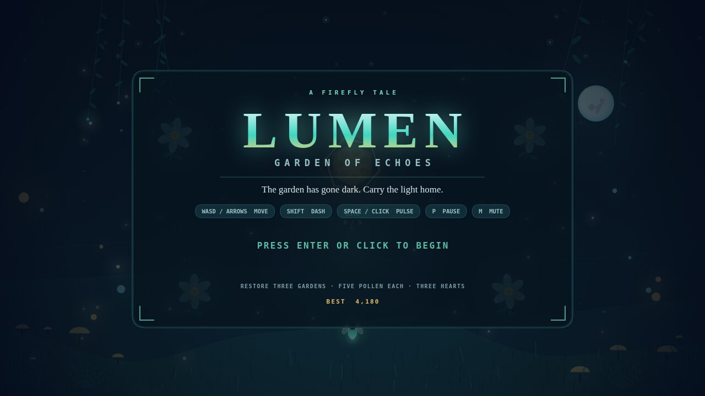
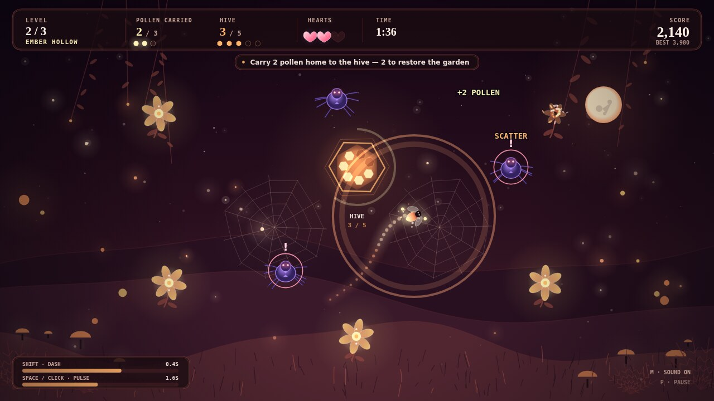
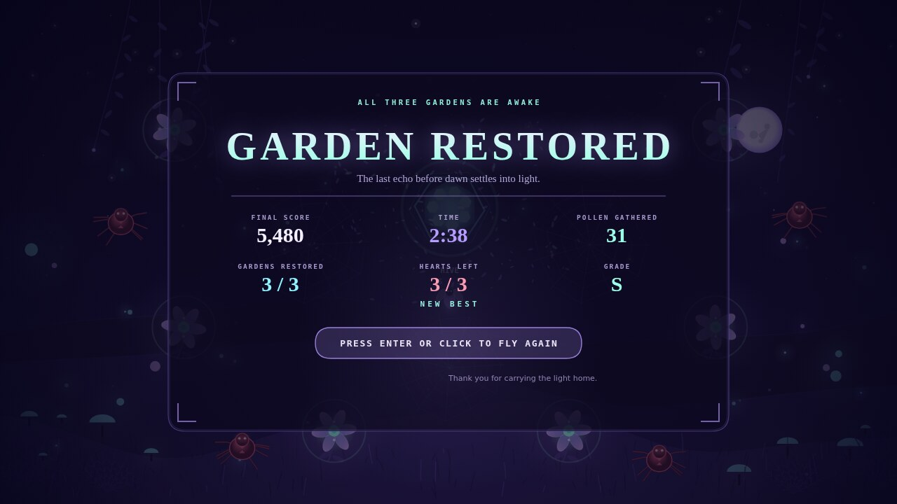
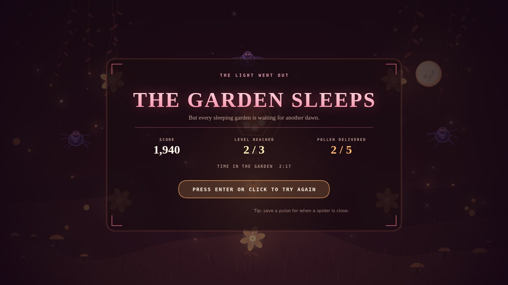

# Lumen: Garden of Echoes

A firefly carries the light back into a sleeping neon garden. Gather pollen from glowing flowers, bring it home to the hive, and keep away from the spiders that wake when the pollen moves. Three gardens, five pollen each, three hearts — a small hand-drawn arcade game in plain canvas and WebAudio, with no assets, libraries or network requests.

[](https://make.fun/bounty/best-game-01)
[](https://make.fun/bounty/best-game-01)
[](https://make.fun/bounty/best-game-01)

## Play

The game is static files: open `game/index.html` in a desktop browser, or serve the folder.

```sh
python3 -m http.server 8123 --directory game
# then open http://127.0.0.1:8123/
```

## Controls

| Input | Action |
| --- | --- |
| `WASD` / arrow keys | Fly |
| `Shift` | Dash (short burst, brief invulnerability, cooldown) |
| `Space` / left click | Pulse (scares nearby spiders away, cooldown) |
| `Enter` / click | Begin, resume or restart |
| `P` / `Esc` | Pause and resume |
| `M` | Mute and unmute |

## How to play

Fly to a glowing flower to pick up pollen — you can carry up to three. Carry it to the hive in the middle of the garden to deposit it; five pollen restores the garden and opens the next one. Spiders chase you, and touching one costs a heart and knocks you back. Dash past them or pulse them away, then bring the light home. Restore all three gardens to win; lose all three hearts and the garden sleeps.

## Screenshots

| | |
| --- | --- |
|  |  |
|  |  |

## Build and hand in

```sh
mkdir -p out && MAKEFUN_OUTPUT_DIR=out node main.ts
```

`main.ts` copies `game/` and `screenshots/` to the output directory and writes `dossier.json` with `vendor/makefun-game.ts`. The optional `?shot=title|play|win|lose&seed=1` query string stages a deterministic frame used for the screenshots above.

## Layout

- `game/src/config.js` — tuning, palettes and level layouts
- `game/src/entities.js` — player, flowers, hive, spiders, particle pools
- `game/src/game.js` — rules and the title/playing/paused/win/lose state machine
- `game/src/render.js` — every canvas drawing routine
- `game/src/input.js`, `audio.js`, `random.js` — keyboard/mouse, generated WebAudio, seeded RNG
- `game/src/shots.js` — deterministic screenshot scenes
- `game/src/main.js` — canvas sizing and the fixed-timestep loop
